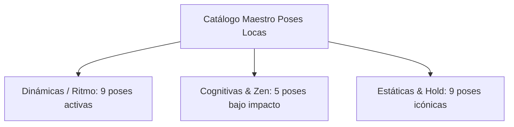
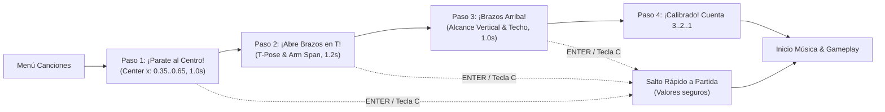

# ESPECIFICACIÓN MAESTRA DE DISEÑO, ARQUITECTURA Y PRODUCTO: POSES LOCAS AR

**Documento:** Gran Especificación Maestra (Master Product & Technical Spec)  
**Versión:** 2.1.0  
**Fecha de actualización:** 11 de Noviembre de 2026  
**Plataformas objetivo:** Linux (Raspberry Pi 5 / XWayland / V4L2), PC de escritorio (Windows/macOS), Smart TV y Android PWA  
**Estado:** Documento Vivo Oficial de Referencia  

---

## 1. VISIÓN DEL PRODUCTO Y FILOSOFÍA DE EXPERIENCIA

**Poses Locas AR** es un videojuego interactivo de baile, ritmo y motricidad en Realidad Aumentada que utiliza visión por computadora en tiempo real (OpenCV + MediaPipe) para detectar el cuerpo completo del jugador sin necesidad de sensores externos, controles físicos ni mandos.

### Pilares Fundamentales:
1. **La Cámara y el Cuerpo como Protagonistas Absolutos:** El jugador debe verse siempre a sí mismo con total nitidez. La interfaz gráfica (HUD) jamás debe tapar las extremidades, el rostro ni la postura del usuario.
2. **Cero Sobrecarga Cognitiva (Foco en el Presente):** El juego no adelanta coreografías futuras ni satura con elementos predictivos en movimiento. Toda la atención está enfocada en la pose activa que se debe ejecutar en el compás actual.
3. **Inclusión y Ergonomía Real:** Adaptación automática a diferentes capacidades físicas y edades mediante perfiles inclusivos (niños pequeños, adultos mayores, entrenamiento cardiovascular o fiesta casual).
4. **Resiliencia de Hardware:** Compatibilidad fluida con cámaras USB y procesadores de bajo consumo (Raspberry Pi 5) garantizando 30-60 FPS continuos sin caídas de framerate.

---

## 2. DIRECTIVAS FUNDAMENTALES DE UI/UX Y ERGONOMÍA VISUAL

### 2.1. Regla de Oro: Brazos Libres Arriba y Viewport Limpio
* **Zona Superior Abierta:** Cuando el jugador levanta los brazos hacia arriba (*Brazos Arriba*, *Letra Y*, *Salto*, confirmación de menú), el espacio superior central (`x: 370..890, y: 0..140`) debe permanecer completamente libre.
* **Banner de Pose Activa Reposicionado Abajo:** El indicador de pose y la barra de mantenimiento se sitúan en la parte inferior centrada (`x: 390..890, y: 634..704`), dejando despejada toda la zona de elevación de brazos.
* **Auto-Ghosting (Opacidad Reactiva Inteligente):** Si las manos, rodillas o cualquier extremidad del jugador entran en el área del banner inferior (`y >= 0.80`), el módulo aplica automáticamente un desvanecimiento instantáneo (`alpha = 0.25`), volviéndose translúcido para que el jugador nunca pierda de vista sus propios movimientos.
* **Eliminación del Carril Predictivo Inferior:** Se prohíbe taxativamente reintroducir carriles deslizantes de poses futuras que ocupen el margen inferior de la pantalla o tapen los pies y piernas.

### 2.2. Tarjeta de Referencia Superior Derecha (Autoexplicativa)
* **Cero Textos Redundantes:** Se eliminan etiquetas de depuración internas como `"ILUSTRACION + COACH VIVO"`. Cada elemento debe explicarse por sí mismo mediante su diseño y animación.
* **Doble Modo Visual conmutador (Tecla `I`):**
  * *Modo Híbrido (Por defecto):* Muestra la ilustración humana a la izquierda (155x155) y el Coach Vivo animado con articulaciones vectoriales a la derecha.
  * *Modo Solo Silueta:* Si la pose no dispone de ilustración o el usuario activa el modo minimalista (`FEATURES.enable_stickman_only`), se muestra únicamente el Coach Vivo centrado con proporciones anatómicas armónicas (ancho 190 px, sin ensanchamiento deformado).

---

## 3. CATÁLOGO MAESTRO DE LAS 23 POSES

El sistema clasifica las poses en tres categorías biomecánicas:

### 3.1. Poses Dinámicas (Basadas en Movimiento Continuo y Ritmo)
1. **Baila! Mueve Caderas:**
   * *Acción del jugador:* Balanceo rítmico pélvico alternado de izquierda a derecha.
   * *Biomecánica:* Oscilación bilateral armónica (amplitud ±0.10) con contrapposto de hombros y pies firmemente anclados al suelo (`y=0.90`). Rodillas con cinemática inversa.
   * *Flechas de intención:* Flecha dorada `DER >` y flecha magenta `< IZQ` indicando el compás musical.
   * *Perfiles:* `JUNIOR`, `CARDIO`, `FIESTA`.
2. **Mueve los Brazos!:**
   * *Acción del jugador:* Agitar y bombear los brazos arriba y abajo al ritmo de la música.
   * *Biomecánica y Sincronización:* Oscilación armónica de hombros (`0.36, 0.32`), codos (`y: 0.28 ± 0.08`) y muñecas (`y: 0.25 ± 0.16`). Cuando el brazo izquierdo sube al cielo (`y` menor), la flecha indicadora izquierda apunta hacia arriba en verde neon y la derecha hacia abajo en magenta, sincronizadas al 100% con el detector.
   * *Doble Modalidad de Detección:* Admite tanto ejecución alternada en antifase (un brazo sube mientras el otro baja) como bombeo simétrico conjunto (ambos brazos arriba y abajo simultáneamente), con filtro de rebote (debounce de 100 ms).
   * *Flechas de intención:* Flechas pulsantes dinámicas con rótulo guía `"BOMBEA BRAZOS"`.
   * *Perfiles:* `JUNIOR`, `CARDIO`, `FIESTA`.
3. **Mueve la Cabeza!:**
   * *Acción del jugador:* Asentir o inclinar la cabeza rítmicamente al compás musical.
   * *Biomecánica:* Nodding sinusoidal suave (`nose.x ± 0.08, nose.y + 0.03`).
   * *Perfiles:* `JUNIOR`, `FIESTA`.
4. **Balanceo Suave Flow!:**
   * *Acción del jugador:* Balanceo lateral relajado de tronco y brazos con respiración coordinada.
   * *Biomecánica:* Desplazamiento pendular continuo de bajo impacto.
   * *Perfiles:* `ZEN`, `FIESTA`.
5. **Boxeo Rápido!:**
   * *Acción del jugador:* Lanzar golpes de jab alternados manteniendo guardia frontal.
   * *Biomecánica:* Extensión contralateral rápida de muñecas hacia el plano medio.
   * *Perfiles:* `CARDIO`, `FIESTA`.
6. **Salto Mortal!:**
   * *Acción del jugador:* Salto vertical con elevación simultánea de brazos.
   * *Biomecánica:* Ciclo de flexión previa, elevación aérea completa y amortiguación de rodillas.
   * *Perfiles:* `CARDIO`, `FIESTA`.
7. **Agacharse!:**
   * *Acción del jugador:* Sentadilla ergonómica bajando el centro de gravedad.
   * *Biomecánica:* Descenso pélvico con apertura simétrica de rodillas manteniendo tobillos firmes.
   * *Perfiles:* `CARDIO`, `FIESTA`.
8. **Girando!:**
   * *Acción del jugador:* Giro corporal de 360 grados en el lugar.
   * *Biomecánica:* Detección de inversión de hombros (rotación de torso).
   * *Perfiles:* `CARDIO`, `FIESTA`.
9. **Guitarra Rock!:**
   * *Acción del jugador:* Tocar guitarra imaginaria (rasgueo en mano derecha, mástil en izquierda).
   * *Biomecánica:* Oscilación rápida de muñeca derecha sobre cadera.
   * *Perfiles:* `JUNIOR`, `CARDIO`, `FIESTA`.
10. **Remolino DJ!:**
    * *Acción del jugador:* Mano izquierda anclada en cadera mientras la mano derecha dibuja círculos continuos en el aire (scratch de vinilo).
    * *Biomecánica:* Rotación angular continua de muñeca alrededor del codo con radio > 0.06 BodyUnit.
    * *Perfiles:* `FLOW`, `FIESTA`.
11. **Fiebre Disco!:**
    * *Acción del jugador:* Estilo John Travolta, alternando mano derecha apuntando alto en diagonal al cielo y bajo cruzando la cadera opuesta.
    * *Biomecánica:* Alternancia rítmica diagonal de muñeca derecha (`y < nose.y` vs `y > shoulder.y + 0.10 BodyUnit`).
    * *Perfiles:* `FLOW`, `CARDIO`, `FIESTA`.
12. **Onda Electro!:**
    * *Acción del jugador:* Brazo derecho extendido en guardia horizontal firme mientras el brazo izquierdo genera una ola ondulante ("wave").
    * *Biomecánica:* Bombeo vertical de muñeca izquierda con brazo derecho bloqueado.
    * *Perfiles:* `FLOW`, `FIESTA`.
13. **Limpiaparabrisas!:**
    * *Acción del jugador:* Ambos brazos en paralelo barriendo de izquierda a derecha en arco continuo como limpiaparabrisas de fiesta.
    * *Biomecánica:* Oscilación simultánea de ambas muñecas por encima de los hombros.
    * *Perfiles:* `FLOW`, `JUNIOR`, `FIESTA`.
14. **De Lado a Lado! (DESACTIVADA TEMPORALMENTE):**
    * *Estado:* Deshabilitada en general para priorizar pruebas estáticas en el lugar. Reemplazada por *Baila! Mueve Caderas*.

### 3.2. Poses Cognitivas y de Coordinación (Bajo Impacto Articular)
15. **Cruzado al Oído!:** Cruce contralateral del brazo izquierdo hacia la oreja derecha mientras el brazo derecho descansa abajo. Reto neuro-motor propioceptivo.
16. **Reloj 9 y 12!:** Brazo izquierdo horizontal a las 9 en punto y brazo derecho vertical a las 12 en punto.
17. **Namasté Zen!:** Ambas palmas unidas en el centro del pecho con codos nivelados.
18. **Marco Egipcio!:** Brazo izquierdo en ángulo hacia arriba y brazo derecho en ángulo hacia abajo formando un marco estilizado.
*(Nota: El modo "Congelados!" fue removido del catálogo por solicitud expresa del usuario para mantener la dinámica de baile activa sin frenar el flujo).*

### 3.3. Poses Estáticas Tradicionales
16. **Brazos Arriba!:** Ambas manos elevadas en V por encima de la cabeza (`pose_brazos.jpg`).
17. **T-Pose!:** Ambos brazos extendidos horizontalmente a 90 grados (`pose_tpose.jpg`).
18. **Fuerte!:** Doble flexión de bíceps estilo culturista con puños arriba (`pose_fuerte.jpg`).
19. **Saludo Militar!:** Mano derecha en la frente en saludo marcial, brazo izquierdo abajo (`pose_saludo.jpg`).
20. **Letra Y!:** Brazos extendidos a 45 grados emulando la canción YMCA (`pose_letra_y.jpg`).
21. **Letra O!:** Brazos curvados sobre la coronilla formando un círculo (`pose_letra_o.jpg`).
22. **Pose de Mono!:** Codos pegados a costillas con manos en axilas imitando a un mono.
23. **Avión Supersónico!:** Inclinación lateral de torso con brazos simulando alas de avión en viraje.

---

## 4. PERFILES INCLUSIVOS DE EXPERIENCIA

| Perfil | Nombre en Pantalla | Filosofía y Selección de Poses | Tolerancia Hold |
| :--- | :--- | :--- | :---: |
| **`FLOW`** | **Freestyle Flow** | 100% dinámico, asimétrico y bailable (Remolino DJ, Fiebre Disco, Onda Electro, Limpiaparabrisas, Caderas, Brazos). **Cero poses estáticas**. | 5.5s (Estándar 1.0x) |
| **`JUNIOR`** | **Aventura Junior** | 100% lúdico, expresivo y centrado en el lugar (caderas, cabeza, mono, avión, brazos arriba). **Sin traslaciones laterales**. | 7.5s (Grace buffer +30%) |
| **`CARDIO`** | **Cardio Groove** | Alto gasto calórico, velocidad y ritmo intenso (saltos, sentadillas, boxeo, giros, caderas). | 5.0s (Grace buffer -15%) |
| **`ZEN`** | **Mente Activa & Zen** | Cero impacto articular, rehabilitación y motricidad fina (cruces contralaterales, Namasté, reloj, marco egipcio). | 8.5s (Grace buffer +50%) |
| **`FIESTA`** | **Fiesta Total** | Todo el catálogo unificado para partidas competitivas o familiares. | 6.0s (Estándar 1.0x) |

---

## 5. REPRODUCCIÓN MUSICAL Y MODO LIBRE INFINITO

* **Canción Continua sin Fin:** En el *Modo Libre*, la música se reproduce con `pygame.mixer.music.play(-1)`. Si por fluctuaciones del driver de audio SDL la pista finaliza, el bucle de juego detecta la inactividad y reinicia el stream de audio inmediatamente, garantizando que la sesión de baile nunca se corte ni se silencie.
* **Control Kinético a Distancia:** El menú inicial permite subir y bajar de canción con la mano izquierda o derecha a distancia, y confirmar manteniendo ambos brazos arriba por 0.9 segundos.

---

## 6. HARDWARE Y COMPATIBILIDAD (RASPBERRY PI 5 / V4L2)

* **Negociación FourCC `MJPG` Obligatoria:** En Linux V4L2, los sensores USB requieren compresión MJPEG para operar a 1280x720 30fps. OpenCV debe invocar `cv2.VideoWriter_fourcc(*'MJPG')` antes de fijar ancho y alto.
* **Warm-Up del Sensor:** Bucle de hasta 12 lecturas consecutivas para estabilizar la exposición lumínica antes de certificar la apertura de cámara.
* **Limpieza de Texto Espejado:** Todo frame sintético de `MockVideoCapture` debe ser simétrico. Los textos de alerta y diagnóstico se dibujan en el HUD **después** del flip horizontal.
* **Lanzador Robusto:** `run_game.sh` elimina procesos huérfanos anteriores con `pkill -f poses_locas.py` para desocupar `/dev/video0`.

---

## 7. ESPECIFICACIÓN DE LA WEB INTERNA DE INSPECCIÓN DE POSES

A fin de permitir al equipo auditar cada pantalla, esquema articular y postura de forma interactiva en cualquier navegador, se define el **Visualizador Interno de Poses (`web_gallery/pose_inspector.html`)**:

### Características de la Herramienta:
1. **Catálogo Interactivo con Filtros:** Visualización por pestañas (Todas, Junior, Cardio, Zen, Estáticas).
2. **Esquema Biomecánico SVG/Canvas en Vivo:** Simulación visual de los puntos articulares en tiempo real.
3. **Ficha de Acción y Comprensión UI/UX:** Indicación textual de cómo pararse y qué acción hacer.
4. **Galería de Ilustraciones Originales:** Vista previa de las imágenes asociadas.
5. **Auditoría Técnica de Comprensión:** Calificación de legibilidad y sugerencias biomecánicas.

---

## 8. SISTEMA DE CALIBRACIÓN PRE-JUEGO Y PROTOCOLO BIOMÉTRICO

Para garantizar que cada partida esté calibrada según la distancia física, altura y envergadura de cada jugador y evitar disparidades o descalibraciones en la cámara, se incorpora la **Fase de Calibración Pre-Juego Obligatoria (`poses_core.calibration.CalibrationManager`)**:

### 8.1. Fases del Flujo de Calibración:
1. **Paso 1: Pararse al Centro (`STEP_CENTER`, 1.0s):**
   * *Objetivo:* Ubicar al jugador en el plano central (`0.35 <= nose_x <= 0.65`) y verificar visibilidad bilateral de hombros.
   * *Métricas guardadas:* Centro de referencia (`calib_center_x`) y escala anatómica base `BodyUnit`.
   * *Feedback visual:* Cuadro central verde neón con línea vertical guía.
2. **Paso 2: T-Pose / Brazos en Cruz (`STEP_T_POSE`, 1.2s):**
   * *Objetivo:* Extender ambos brazos horizontalmente a 90 grados.
   * *Métricas guardadas:* Envergadura de brazos (`arm_span`), verificación de que las muñecas no salgan de los bordes laterales (`x < 0.04` o `x > 0.96`). Si las manos se cortan, el sistema instruye al usuario a dar un paso atrás.
   * *Feedback visual:* Línea horizontal guía a la altura de los hombros con flechas expansivas hacia los costados.
3. **Paso 3: Brazos al Cielo (`STEP_ARMS_UP`, 1.0s):**
   * *Objetivo:* Levantar ambos brazos por encima de la cabeza.
   * *Métricas guardadas:* Altura máxima de alcance (`reach_y`), confirmación de que la cámara no corta el techo.
   * *Feedback visual:* Flechas verdes de elevación ascendente hacia el límite superior de pantalla.
4. **Paso 4: Confirmación y Cuenta Regresiva (`STEP_READY`, 0.8s):**
   * *Feedback visual:* Círculo central iluminado con aviso `¡VAMOS!` y arranque sincronizado de música y poses.

### 8.2. Control y Accesibilidad:
* **Salto Rápido:** Presionando `ENTER` o la tecla `C`, el usuario puede saltar la calibración en cualquier momento y arrancar de inmediato con los parámetros seguros por defecto.
* **Recalibración en Caliente:** Durante la partida, presionar la tecla `C` pausa la pista musical y reabre la calibración en tiempo real si otro jugador toma el turno.

